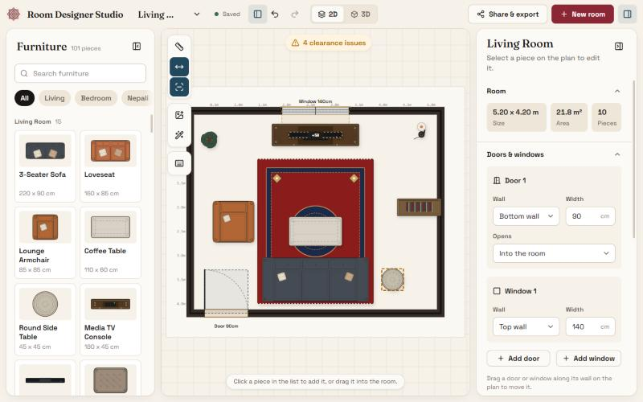
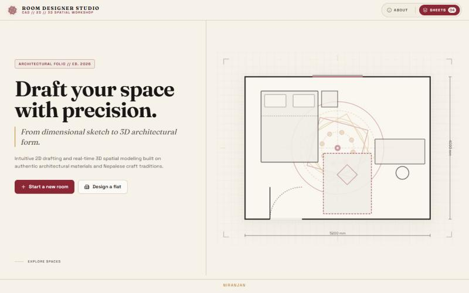
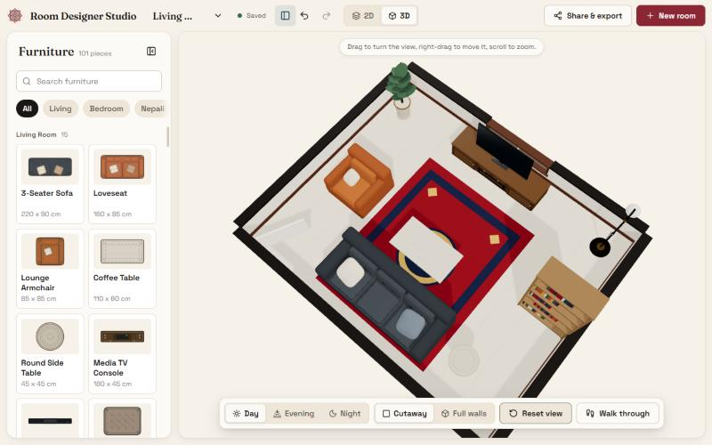
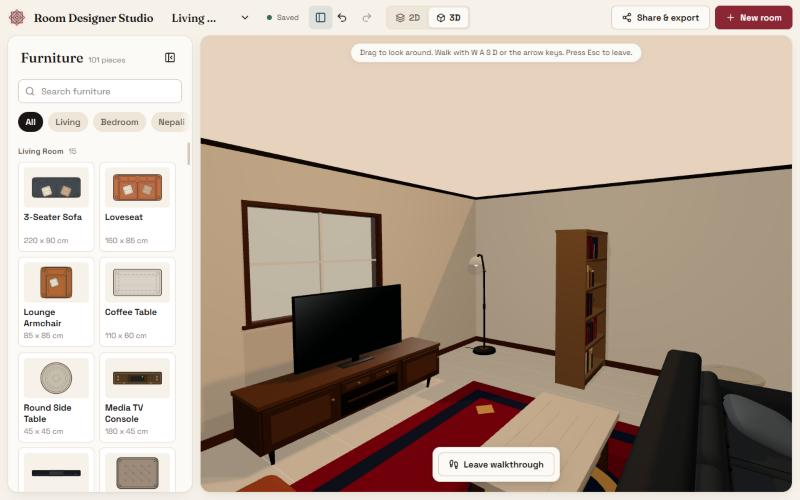
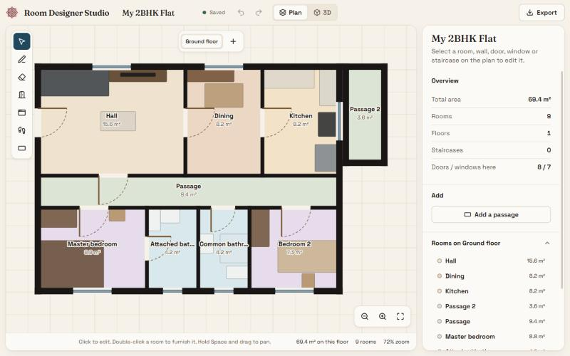
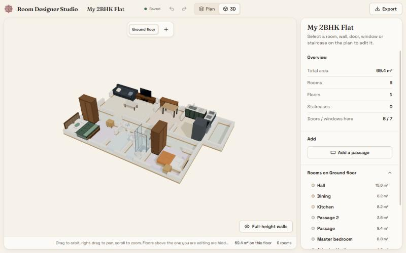
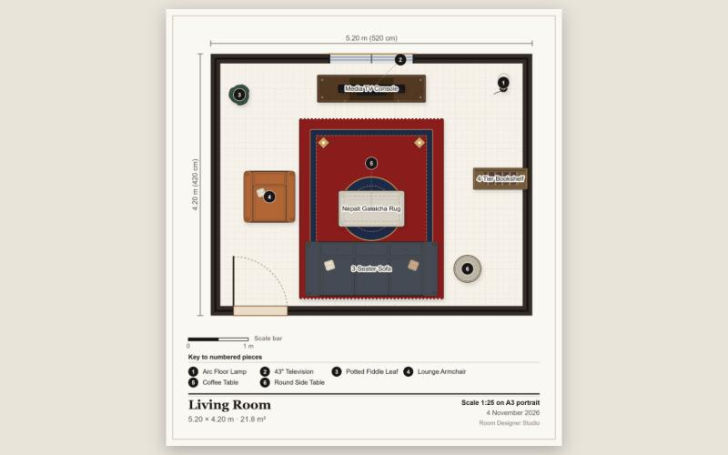
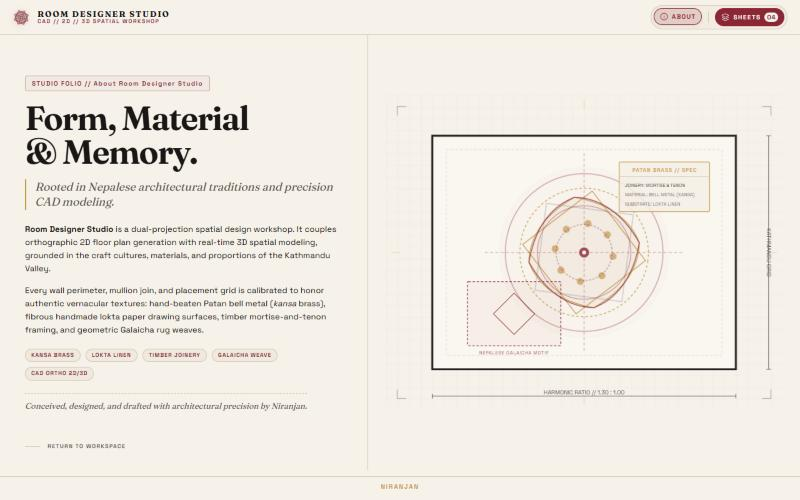

# Room Designer Studio

Plan a room or a whole flat on a 2D plan, check that the furniture fits, and walk around it in 3D. It runs entirely in the browser: designs stay on your device, with no account, no cloud and no prices.

[](https://github.com/itsniranjannn/RoomDesigner/actions/workflows/ci.yml)




## Highlights

- **Room designer** with a 2D plan and a live 3D view of the same room, 101 furniture pieces (modern and Nepali), doors and windows.
- **Flat designer**: draw walls, get rooms automatically, or start from Studio, 1BHK, 2BHK or 3BHK presets.
- **Checks as you place**: collisions, door swings, blocked windows and cramped walking gaps.
- **Export** the floor plan as PNG or PDF, the 3D view as a PNG (twice the screen size, with a title strip), or the design as JSON, or share the whole design as a link. File names carry the design name and the date.
- **Local and offline**: stored in IndexedDB, installable as a PWA.



## Room designer

Drag pieces from the catalog onto the plan. Rotate, resize (0.4x to 2.5x), recolor, copy, and select several at once with shift-click or a drag box. Small items stack on furniture, so a TV sits on its console and a lamp on a nightstand, and they drop back to the floor when moved away.

- **Clearance warnings** list door-swing zones, obstructed windows and cramped walking gaps.
- **Measure** between any two points; the selected piece shows live distances to every wall.
- **Layout suggestions** place a preset (bedroom, living, dining, study, Nepali sitting room) against the walls, clear of doors and windows.
- **Trace image**: import a photo or scan of a floor plan and draw over it with adjustable opacity and scale.
- **Photo to 3D furniture**: add 2 to 5 photos of a piece, or one product sheet showing several views, on a white or dark background (My Furniture, Create from photos). The app reads the type of furniture, proportions and colours from them and builds a catalog-style model from the same parts as the built-in furniture (sofas with tufted backs, rounded arms and tapered legs, wood-frame lounge chairs, beds, tables, storage); the 2D plan shows your own top photo cut out. Everything happens in your browser and photos are never uploaded.
- Undo and redo, and doors and windows you can drag along their wall.

## 3D view and walkthrough

The 3D view mirrors the plan. Orbit, pan and zoom, switch between cutaway and full walls, and choose day, evening or night lighting.



**Walk through** drops you into the room in first person (`W A S D`, drag to look, `Esc` to leave).



## Flat designer

Choose **Design a flat** on the start page. Draw and erase walls on a grid and enclosed areas become rooms. Remove a wall to merge two rooms, add doors and windows, add passages in any of four directions, and place straight, L or U staircases across multiple floors. Name each room (hall, bedroom, kitchen, bathroom), then double-click a room to furnish it in the room designer; a breadcrumb and room switcher move you between rooms without going back.



The whole flat is also available in 3D.



## Export and share

PNG and PDF exports are drawn from the same symbols as the editor (tints, photo cut-outs and stacked items included), with a scale bar, a numbered key to the pieces and the room area. The 3D view exports as its own PNG, for a room and for a flat (the flat export can save the plan and the 3D picture together). Rooms also export to JSON and import back. Share links carry the whole design in the URL, so nothing is uploaded.



The About page tells the story behind the design language.



## Quick start

Requires Node.js 20 or newer.

```bash
git clone https://github.com/itsniranjannn/RoomDesigner.git
cd RoomDesigner
npm install
npm run dev
```

Open the URL Vite prints (by default `http://localhost:5173`) in a WebGL-capable browser.

| Script                 | What it does                       |
| :--------------------- | :--------------------------------- |
| `npm run dev`          | Start the dev server               |
| `npm run build`        | Production build into `dist/`      |
| `npm run preview`      | Serve the production build locally |
| `npm test`             | Run the Vitest suite               |
| `npm run lint`         | ESLint                             |
| `npm run format`       | Format with Prettier               |
| `npm run format:check` | Check formatting (used in CI)      |

## Keyboard shortcuts

Press `?` on the 2D plan to see the room list in the app.

| Keys                        | Action                                             | Where         |
| :-------------------------- | :------------------------------------------------- | :------------ |
| Click, Shift + Click, drag  | Select, add or remove a piece, box-select          | Room plan     |
| Arrows                      | Nudge 1 cm (Shift: 10 cm)                          | Room plan     |
| `R`                         | Rotate 15 degrees (Shift: 45)                      | Room plan     |
| Ctrl + A / C / V / D        | Select all, copy, paste, duplicate                 | Room plan     |
| Delete                      | Remove selection                                   | Room plan     |
| Ctrl + Z / Y                | Undo, redo                                         | Room, flat    |
| `M`                         | Measure distance                                   | Room plan     |
| `Esc`                       | Clear selection or leave measuring                 | Room plan     |
| Drag, right-drag            | Orbit, pan                                         | 3D view       |
| `W A S D`, `Esc`            | Walk, leave the walkthrough                        | 3D view       |
| `V` `W` `E` `D` `N` `S` `P` | Select, wall, erase, door, window, stairs, passage | Flat designer |
| `R`                         | Rotate the stairs or passage tool or selection     | Flat designer |
| Delete                      | Remove selection                                   | Flat designer |

## How it works

- **Collision and clearance.** Pieces are rotated rectangles. Overlaps and wall containment use the Separating Axis Theorem (`src/engine/collision.js`). `clearance.js` flags door-swing zones, obstructed windows and walking gaps between 25 and 60 cm.
- **One source for drawings.** The editor and the PNG/PDF export build from shared piece symbols and a sheet model (`sheetModel.js`, `exportPlan.js`), so exports match what you see.
- **Share links.** A design is compressed, base64url-encoded and placed in the URL hash (`#share=...`), then decoded on load. Nothing leaves the browser, and a design too large for a link is refused rather than truncated.
- **Persistence.** Zustand stores hold the live state. Saves are debounced and written to IndexedDB (`idb`) in three object stores: rooms, custom (photo-made) furniture and flats. The last open room is remembered in `localStorage`.
- **Offline.** A service worker is registered in production builds only, so dev hot-reload is never cached.

## Project structure

```text
src/
  App.jsx, main.jsx
  components/
    canvas/      2D plan: pieces, silhouettes, grid, collision overlays
    catalog/     Furniture catalog and search
    common/      Buttons, modals, popovers, tooltips and other shared UI
    export/      Plan sheets used by PNG and PDF export
    flat/        Flat designer: plan canvas, 3D view, inspector, toolbar
    inspector/   Room and piece panels
    layout/      App shell, landing, about, sheets panel, top bar
    preview3d/   Room 3D view, walls, walkthrough, furniture models
    tools/       Layout, share, shortcuts and photo-model dialogs
  data/          Furniture catalog and IndexedDB persistence
  design/        Design tokens and global CSS
  engine/        Pure logic: collision, clearance, stacking, layout, snapping,
                 measure, share, export (PNG, PDF, JSON), flat walls and presets
  store/         Zustand stores for rooms and flats
public/          Web manifest, service worker, icon
docs/assets/     README screenshots
```

## Testing and contributing

Tests live next to the code (`*.test.js`) and cover the engine (collision, hull, stacking, flats, passages, export), the stores and persistence, and some components. CI (`.github/workflows/ci.yml`) runs `npm ci`, lint, `format:check`, tests and a build on every push to `main` and on pull requests. Run the same before opening one:

```bash
npm run lint && npm run format:check && npm test && npm run build
```

## Built with

React 19, Vite 6, Zustand, three.js with React Three Fiber and drei, `idb`, Framer Motion and Lucide icons.

## License

No license file is included in this repository, so all rights are reserved by the author.

Made by Niranjan, inspired by the craft and materials of the Kathmandu Valley.
