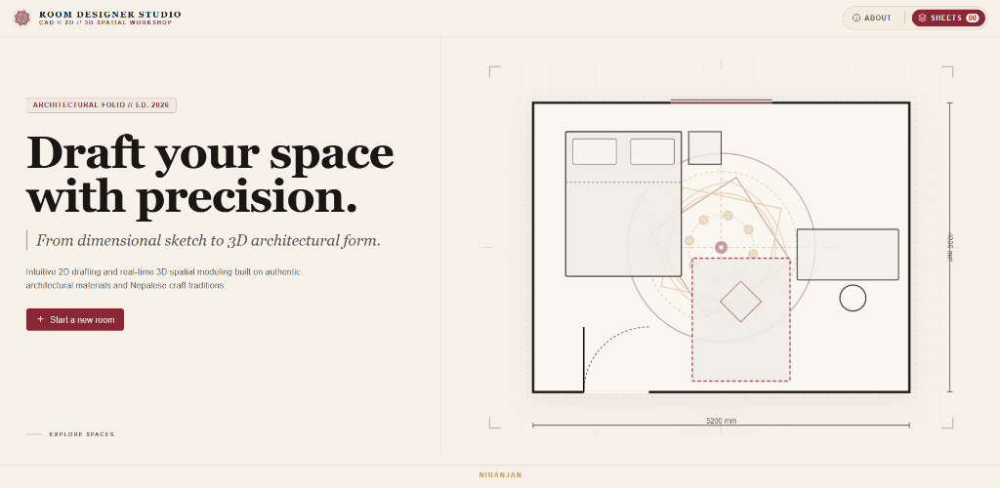
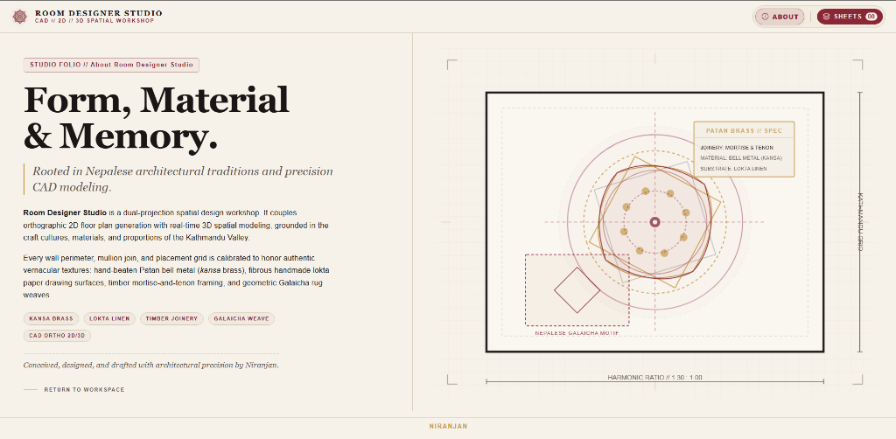
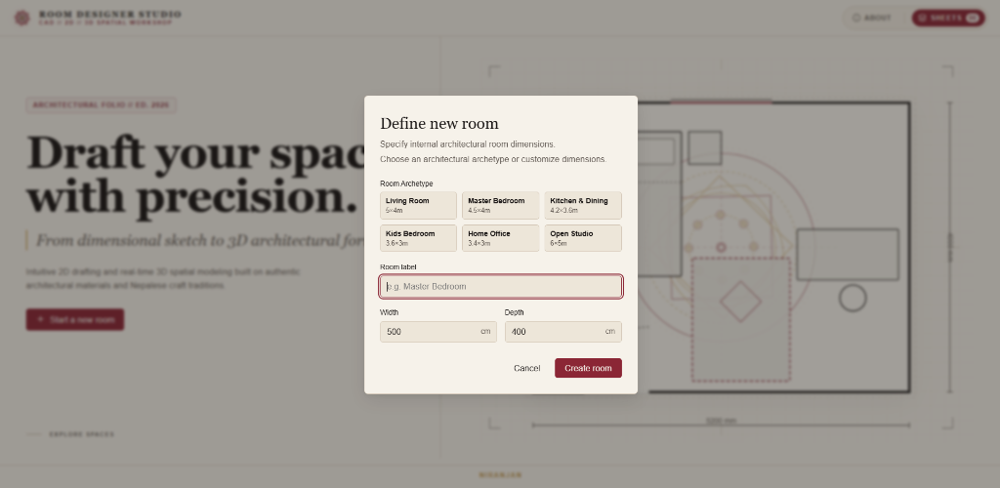
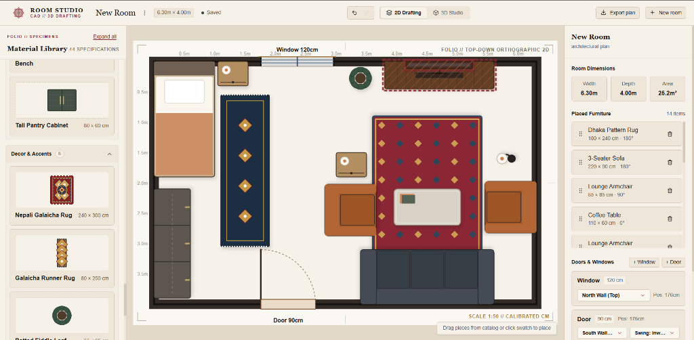
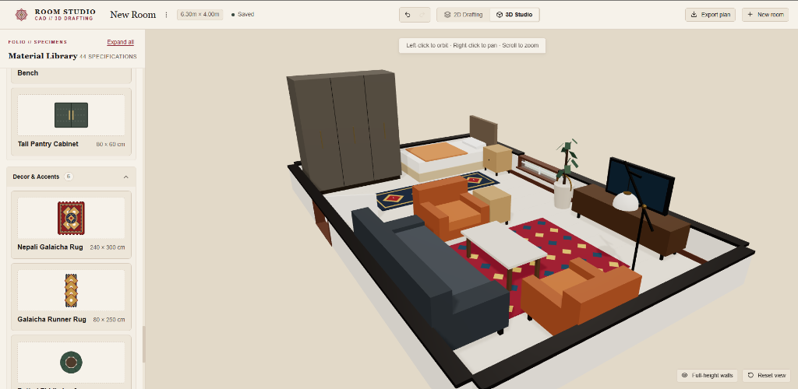

<div align="center">

# 🏛️ ROOM DESIGNER STUDIO
### *CAD // 2D // 3D Spatial Workshop Grounded in Vernacular Craft & Precision Engineering*

<p align="center">
  
  
  
  
</p>

<p align="center">
  <a href="#-project-showcase"></a>
  <a href="#-core-merits--architectural-distinctions"></a>
  <a href="#-cultural-material-palette"></a>
  <a href="#-quick-start--development"></a>
</p>

---

<p align="center">
  <b>Room Designer Studio</b> is an architectural drafting environment that unites high-fidelity <b>2D orthographic plan generation</b> with <b>real-time 3D spatial modeling</b>, inspired by the craft cultures, materials, and sacred geometries of the Kathmandu Valley.
</p>

</div>

<br/>

<div align="center">
  <table width="100%" style="border-collapse: collapse; border: none;">
    <tr>
      <td width="33%" align="center" style="background-color: #FBF9F5; padding: 18px; border-radius: 12px; border: 1px solid #E8DFD1;">
        <span style="font-size: 24px;">📐</span><br/>
        <b style="color: #8B2635; font-size: 15px;">DUAL PROJECTION</b><br/>
        <span style="color: #5C5247; font-size: 12px;">Plan-view 2D drafting with instantaneous sync to 3D Three.js spatial meshes.</span>
      </td>
      <td width="33%" align="center" style="background-color: #FBF9F5; padding: 18px; border-radius: 12px; border: 1px solid #E8DFD1;">
        <span style="font-size: 24px;">🪔</span><br/>
        <b style="color: #C49746; font-size: 15px;">VERNACULAR CRAFT</b><br/>
        <span style="color: #5C5247; font-size: 12px;">44+ specs featuring Patan kansa brass, lokta paper, Galaicha rugs & Jali screens.</span>
      </td>
      <td width="33%" align="center" style="background-color: #FBF9F5; padding: 18px; border-radius: 12px; border: 1px solid #E8DFD1;">
        <span style="font-size: 24px;">🔒</span><br/>
        <b style="color: #22485E; font-size: 15px;">LOCAL-FIRST ENGINE</b><br/>
        <span style="color: #5C5247; font-size: 12px;">IndexedDB persistence with 0% data egress, no accounts, and full offline readiness.</span>
      </td>
    </tr>
  </table>
</div>

<br/>

---

## 📸 Project Showcase

<div align="center">

### 01 // Architectural Folio Landing
*Monograph-style editorial hero featuring animated drafting grids, dynamic blueprint borders, dimension indicators, and Nepali mandala geometry.*

<br/>

<kbd>
  
</kbd>

<br/><br/>

### 02 // Form, Material & Memory (About Folio)
*A tribute to Newari architectural proportions, mortise-and-tenon timber joinery, hand-beaten Patan bell metal (kansa), and handmade fibrous Lokta linen.*

<br/>

<kbd>
  
</kbd>

<br/><br/>

### 03 // Dimensional Archetype Definition
*Intuitive modal to instantiate standard architectural room footprints (Living, Master Bedroom, Kitchen & Dining, Studio) or calibrate custom metric bounds.*

<br/>

<kbd>
  
</kbd>

<br/><br/>

### 04 // 2D Orthographic Drafting Canvas
*Precision-calibrated 1:50 drafting sheet with dynamic door/window aperture cutouts, magnetic snapping, multi-tier collision warning overlays, and item HUD inspector.*

<br/>

<kbd>
  
</kbd>

<br/><br/>

### 05 // Real-Time 3D Spatial Studio
*Direct procedural translation into 3D space with dynamic wall extrusion, realistic directional shadows, surface elevation logic (TV atop console), and orbit navigation.*

<br/>

<kbd>
  
</kbd>

</div>

<br/>

---

## 💎 Core Merits & Architectural Distinctions

<table width="100%">
  <thead>
    <tr style="background-color: #F6F2EA;">
      <th align="left" width="28%" style="color: #1A1615;">Distinction</th>
      <th align="left" style="color: #1A1615;">Engineering & Design Impact</th>
    </tr>
  </thead>
  <tbody>
    <tr>
      <td><b>🔄 Seamless Bi-Projection</b></td>
      <td>Changes made on the 2D orthographic canvas (rotation, position, dimensions, layer hierarchy) update synchronously in the 3D WebGL viewport without state discrepancy or re-rendering stutter.</td>
    </tr>
    <tr>
      <td><b>🇳🇵 Vernacular Craft Library</b></td>
      <td>Comprehensive catalog containing <b>44+ specifications</b>. Bridges contemporary modern Scandinavian layouts with indigenous heritage items: <i>Dhaka Rugs, Galaicha Runners, Charpai Daybeds, Pirka low stools, Diyo stands, and Carved Jali Screens</i>.</td>
    </tr>
    <tr>
      <td><b>⚡ Rotated SAT Collision Engine</b></td>
      <td>Features custom Separating Axis Theorem (SAT) collision math and boundary-clamp algorithms that highlight collisions in real-time red strokes if pieces encroach upon perimeter walls or each other.</td>
    </tr>
    <tr>
      <td><b>🪜 Intelligent Stacking Matrices</b></td>
      <td>Objects understand elevation and parent-child physical dependencies. Media consoles automatically nest TVs at correct surface heights regardless of insertion order; rugs remain anchored to floor elevation.</td>
    </tr>
    <tr>
      <td><b>🛡️ 100% Privacy & Local-First</b></td>
      <td>All designs, floor plans, and layout sheets reside securely in browser <b>IndexedDB</b> storage. Zero cloud egress, zero login barriers, zero tracking.</td>
    </tr>
    <tr>
      <td><b>🖨️ Presentation Blueprint Export</b></td>
      <td>One-click high-resolution raster export of architectural drawings with professional dimensional callouts and layout statistics.</td>
    </tr>
  </tbody>
</table>

<br/>

---

## 🎨 Cultural Material Palette

Inspired by the earthy materials, red ochre temples, and metallurgic heritage of Patan and the Kathmandu Valley:

<div align="center">

| Swatch | Color Code | Token Name | Cultural & Architectural Material Role |
| :---: | :---: | :--- | :--- |
|  | `var(--color-linen)` | **Lokta Linen** (`#F6F2EA`) | Fibrous handmade lokta paper base & backdrop |
|  | `var(--color-linen-surface)` | **Drafting Surface** (`#EDE6D9`) | Calibrated drafting board & plan backing |
|  | `var(--color-ink)` | **Aged Sal Timber** (`#1A1615`) | Structural framing, walls, and technical linework |
|  | `var(--color-maroon)` | **Rato Simrik** (`#8B2635`) | Sacred vermilion red / primary interactive accents |
|  | `var(--color-brass)` | **Patan Bell Metal** (`#C49746`) | Kansa brass alloy details, icons & markers |
|  | `var(--color-indigo)` | **Himalayan Indigo** (`#22485E`) | Active selection rings and focal elements |
|  | `var(--color-pine)` | **Himalayan Pine** (`#3B4B42`) | Natural flora, garden elements & balanced accents |

</div>

<br/>

---

## 🏗️ System Architecture & Workflow

```text
┌────────────────────────────────────────────────────────────────────────┐
│                        ROOM DESIGNER STUDIO                            │
└────────────────────────────────────────────────────────────────────────┘
                                    │
           ┌────────────────────────┴────────────────────────┐
           ▼                                                 ▼
┌──────────────────────┐                          ┌──────────────────────┐
│  2D DRAFTING ENGINE  │                          │  3D SPATIAL STUDIO   │
│  - SVG Silhouettes   │                          │  - Three.js / R3F    │
│  - Snap-to-Grid Math │                          │  - Procedural Meshes │
│  - Rotated SAT Hull  │                          │  - Shadow/Lighting   │
└──────────┬───────────┘                          └──────────┬───────────┘
           │                                                 │
           └────────────────────────┬────────────────────────┘
                                    ▼
                ┌───────────────────────────────────────┐
                │        UNIFIED ZUSTAND STORE          │
                │  - Active Room Dimensions & Openings  │
                │  - Furniture Instances & Hierarchy    │
                │  - Collision / Boundary ID Sets       │
                │  - Undo / Redo Temporal Snapshots     │
                └───────────────────┬───────────────────┘
                                    ▼
                ┌───────────────────────────────────────┐
                │         INDEXEDDB CLIENT DB           │
                │  - Debounced Local Serialization      │
                │  - Multi-Room "Sheets" Workspace      │
                └───────────────────────────────────────┘
```

<br/>

---

## 🛠️ Technology Stack

<div align="center">

| Core Framework | 3D Visualization | State & Storage | Design & Motion |
| :---: | :---: | :---: | :---: |
| <br/>Concurrent UI | <br/>WebGL Canvas | <br/>Unified Store | <br/>Smooth Gestures |
| <br/>Build Engine | <br/>Declarative 3D | <br/>Zero-Cloud Storage | <br/>Clean Linework |

</div>

<br/>

---

## ⚡ Quick Start & Development

### 1. Requirements
Ensure you have **Node.js (>= 18.0.0)** installed.

### 2. Installation & Setup
```bash
# Clone the repository
git clone https://github.com/itsniranjannn/RoomDesigner.git

# Enter the project directory
cd RoomDesigner

# Install dependencies
npm install

# Start development server
npm run dev
```
Open **`http://localhost:5173`** in any WebGL-capable browser.

### 3. Build & Production Deployment
```bash
# Build the optimized production bundle
npm run build

# Preview production build locally
npm run preview
```

<br/>

---

## ⌨️ Shortcuts & Workspace Controls

<div align="center">

| Command | Action | Active Context |
| :--- | :--- | :--- |
| <kbd>Click</kbd> + <kbd>Drag</kbd> | Move furniture / Pan drafting sheet | 2D Canvas |
| <kbd>R</kbd> | Rotate selected item by 45° or 90° | 2D Canvas |
| <kbd>↑</kbd> <kbd>↓</kbd> <kbd>←</kbd> <kbd>→</kbd> | Nudge item 1 cm (Hold <kbd>Shift</kbd> for 10 cm) | 2D Canvas |
| <kbd>Ctrl</kbd> + <kbd>D</kbd> | Duplicate active item | 2D Canvas |
| <kbd>Delete</kbd> / <kbd>Backspace</kbd> | Remove item from plan | 2D Canvas |
| <kbd>Left Click</kbd> + <kbd>Drag</kbd> | Orbit 3D perspective camera | 3D Studio |
| <kbd>Right Click</kbd> + <kbd>Drag</kbd> | Pan 3D camera | 3D Studio |
| <kbd>Scroll</kbd> | Zoom in / Zoom out | 2D & 3D |

</div>


<br/>

---

<div align="center">

### 🏛️ Room Designer Studio
*Conceived, designed, and drafted with architectural precision by **Niranjan**.*
*Inspired by the timeless craft, geometry, and material traditions of the Kathmandu Valley.*

<p align="center">
  
  
</p>

</div>

</div>

